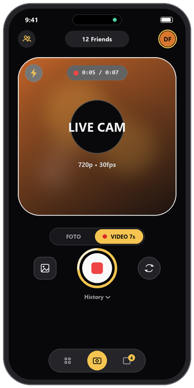
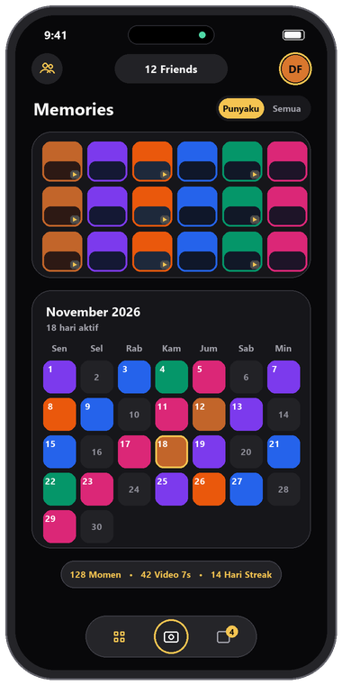

<div align="center">

# 🟡 Depong — Berbagi Momen Foto Sahabat Terdekat

**Abadikan momen harianmu dengan kamera depan & belakang sekaligus, lalu kirim langsung ke layar sahabat terdekatmu.**


</div>

---

## ✨ Tentang Depong

**Depong** adalah aplikasi web *mobile-first* yang terinspirasi dari widget berbagi momen antar sahabat dekat (*close friends*). Dengan tampilan gelap elegan bernuansa emas, Depong dirancang agar ringan, cepat, dan nyaman digunakan langsung dari browser HP maupun dipasang ke layar utama (*Add to Home Screen*).

---

## 📱 Tampilan Aplikasi

| 1. Kamera | 2. Feed Momen & Reaksi | 3. Memories & Kalender |
| :---: | :---: | :---: |
|  |  |  |
| Ambil foto 2 bagian (kamera belakang & depan), ganti lensa `0,5x` / `1x`, dan geser layar untuk memilih filter. | Lihat kiriman foto terbaru dari sahabat, kirim reaksi emoji melayang, dan balas pesan secara langsung. | Jelajahi kolase kenangan dan kalender visual harian lengkap dengan penghitung *streak*. |

---

## 🚀 Fitur Utama

- **📸 Foto Dual-Camera (Belakang + Depan):**
  - Cukup tekan tombol kamera 2 kali tanpa perlu membalik kamera secara manual: jepretan pertama mengambil **kamera belakang** (bingkai besar), lalu otomatis beralih ke **kamera depan** (bingkai kecil di pojok kiri atas).
- **🔍 Pilihan Lensa `0,5x` & `1x`:**
  - Mendukung pergantian lensa ultra-wide `0,5x` dan normal `1x` langsung dari dalam bingkai kamera bagi perangkat yang memiliki kamera wide.
- **🎨 Filter Geser (*Swipe Filter*):**
  - Geser ke kiri atau kanan di atas bingkai kamera untuk berganti filter (*Normal*, *Golden Hour*, *Vintage 90s*, *Soft Glow*, *Sunset Rose*, *Cinema Cool*, dan *Mono B&W*).
- **⚡ Feed Momen & Reaksi Cepat:**
  - Lihat momen terbaru dari seluruh sahabat atau filter per orang, berikan reaksi emoji cepat (`💛`, `🔥`, `😍`), dan kirim balasan singkat.
- **🗓️ Memories & Kalender Visual:**
  - Seluruh foto yang dibagikan tersusun rapi dalam kolase dan kalender bulanan bergambar lengkap dengan statistik *streak* harian.
- **👥 Lingkaran Sahabat Privat (*Close Friends*):**
  - Foto hanya dapat dilihat oleh pengguna yang sudah saling terhubung melalui **kode undangan** atau **link undangan**. Jika pertemanan dihapus, foto mantan teman otomatis ikut dibersihkan.
- **📲 Bisa Dipasang di Layar Utama HP:**
  - Mendukung pemasangan langsung ke *Home Screen* iPhone maupun Android agar terasa seperti aplikasi native.

---

## �️ Struktur Direktori File

```text
├── public/
│   ├── icons/                  # Ikon PWA (192x192, 512x512, maskable)
│   └── screenshots/            # Gambar pratinjau tampilan aplikasi
├── src/
│   ├── app/
│   │   ├── globals.css         # Tema warna Locket Dark & animasi custom Tailwind v4
│   │   ├── layout.tsx          # Root layout & konfigurasi viewport mobile/PWA
│   │   ├── manifest.ts         # Web App Manifest untuk instalasi ke Home Screen
│   │   └── page.tsx            # Halaman utama aplikasi
│   ├── components/
│   │   ├── DepongApp.tsx       # Orkestrator state utama, navigasi, Realtime & Mode Demo
│   │   ├── CameraView.tsx      # Viewfinder kamera, capture foto & rekam video 7 detik
│   │   ├── FeedView.tsx        # Vertical snap feed, auto-play video & floating emoji
│   │   ├── MemoriesView.tsx    # Kolase galeri & kalender visual bulanan
│   │   ├── FriendsSheet.tsx    # Panel daftar sahabat, kode & link undangan
│   │   ├── ProfileSheet.tsx    # Panel edit profil & panduan install PWA
│   │   ├── ActivitySheet.tsx   # Panel daftar reaksi & balasan masuk
│   │   ├── AuthView.tsx        # Halaman Masuk / Daftar & tombol Mode Demo
│   │   ├── MomentMedia.tsx     # Komponen pemutar foto/video 7s & thumbnail
│   │   ├── Avatar.tsx          # Avatar inisial dengan gradien unik per user
│   │   ├── Sheet.tsx           # Komponen bottom-sheet modal
│   │   └── Icons.tsx           # Kumpulan ikon SVG ringan
│   └── lib/
│       ├── supabase.ts         # Inisialisasi Supabase client & helper URL media
│       ├── api.ts              # Fungsi query/mutasi ke tabel & storage Supabase
│       ├── media.ts            # Helper MediaRecorder 7s, crop persegi & kompresi gambar
│       ├── format.ts           # Helper format waktu, tanggal kalender & perhitungan streak
│       ├── demoData.ts         # Data awal untuk Mode Demo lokal
│       └── types.ts            # Definisi tipe TypeScript
├── supabase/
│   └── schema.sql              # Skema SQL lengkap (Tabel, Trigger, RPC, RLS & Storage Bucket)
└── .env.example                # Template environment variable Supabase
```

