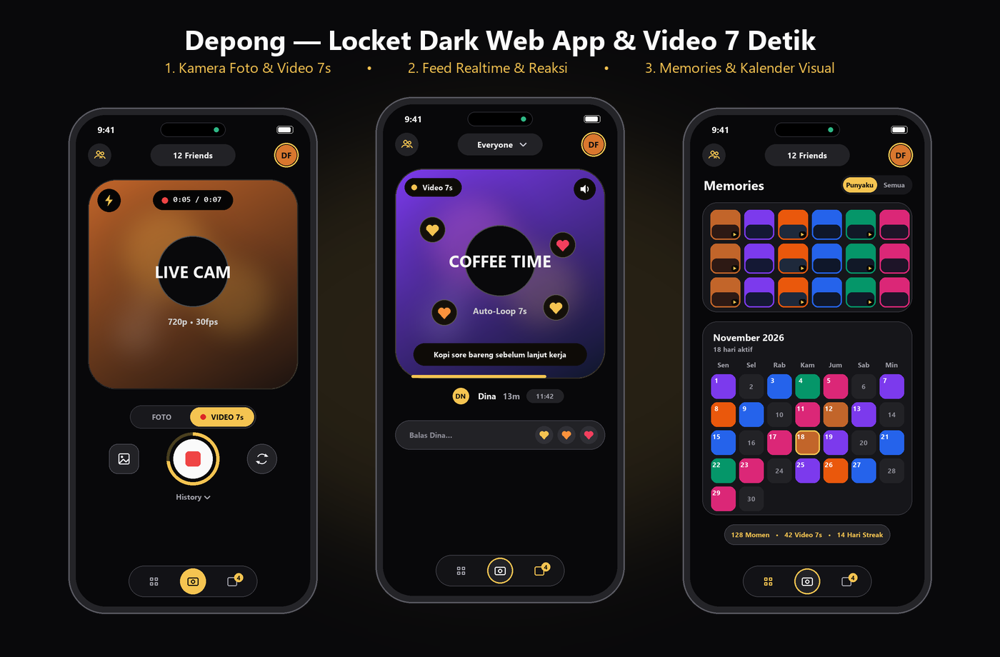
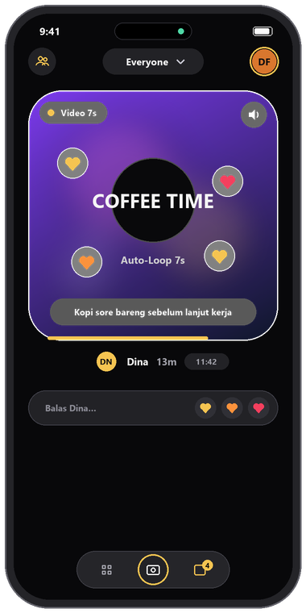

<div align="center">

# 🟡 Depong Widget — Locket-Style Web App (Foto & Video 7 Detik)

**Berbagi foto & klip video 7 detik secara *real-time* langsung ke layar sahabat terdekatmu.**  
Dibangun dengan **Next.js (App Router)**, **TypeScript**, **Tailwind CSS v4**, **WebRTC (`MediaRecorder`)**, dan **Supabase**.



</div>

---

## ✨ Mengenal Project Ini

**Depong** adalah aplikasi web *mobile-first* (mendukung **PWA / Add to Home Screen**) yang terinspirasi dari **Locket Widget** dengan tambahan kemampuan merekam dan mengirim **video singkat berdurasi maksimal 7 detik**.

Dirancang dengan estetika **Locket Dark Mode + Gold Accent** (`#050505` & `#F5C451`), aplikasi ini menyediakan **Mode Demo Instan** (bisa langsung dicoba di browser tanpa perlu login terlebih dahulu) sekaligus siap terhubung penuh ke **Supabase** (Auth, PostgreSQL Database, Storage, dan Realtime).

---

## 📱 Tampilan Layar Aplikasi (Screenshots)

| 1. Kamera Foto & Video 7s | 2. Feed Momen & Reaksi | 3. Memories & Kalender Visual |
| :---: | :---: | :---: |
|  |  |  |
| Viewfinder *squircle* dengan *switch* **`FOTO` \| `VIDEO 7s`**, *gold progress ring* otomatis 7 detik, *flash*, *flip camera*, & unggah dari galeri. | *Vertical snap feed* dengan *auto-loop* video 7 detik, tombol *mute/unmute*, kolom balas pesan, dan animasi reaksi melayang. | Kolase foto/video terbaru, kalender visual bulanan di setiap tanggal aktif, serta penghitung *daily streak*. |

---

## 🚀 Fitur Utama

- **🎥 Kamera Web & Rekam Video 7 Detik:**
  - Membuka kamera depan/belakang langsung dari browser (`navigator.mediaDevices.getUserMedia`).
  - Perekaman video menggunakan `MediaRecorder` API dengan *circular gold progress bar* yang otomatis berhenti tepat di **7 detik** dan memilih *codec* terbaik (`video/mp4` / `video/webm`) agar ringan (~1–2 MB).
- **⚡ Feed Realtime & Reaksi Cepat:**
  - Sinkronisasi momen dan reaksi secara langsung menggunakan **Supabase Realtime**.
  - Kirim reaksi cepat (`💛`, `🔥`, `😍`) dengan efek *floating emoji* atau balas pesan langsung ke pemilik momen.
- **🗓️ Memories & Kalender Bulanan:**
  - Arsip kolase momen milik sendiri maupun seluruh sahabat, dilengkapi kalender bulanan bergambar dan statistik *streak* harian.
- **👥 Sistem Sahabat Dekat (*Close Friends*):**
  - Setiap pengguna memiliki **kode undangan 8 karakter** unik dan **link undangan otomatis** (`?invite=KODE`).
  - Pertemanan otomatis berlaku **2 arah (mutual)** dengan batas maksimal 20 sahabat terdekat.
- **📲 Progressive Web App (PWA) & Mode Demo:**
  - Dilengkapi `manifest.webmanifest` dan panduan instalasi ke layar utama (*Add to Home Screen*) untuk iOS Safari & Android Chrome.
  - Tersedia **Mode Demo** untuk mencoba kamera, video 7 detik, feed, dan kalender langsung di browser tanpa setup database terlebih dahulu.

---

## 🗂️ Struktur Direktori File

```text
├── public/
│   ├── icons/                  # Ikon PWA (192x192, 512x512, maskable)
│   └── screenshots/            # Gambar pratinjau tampilan aplikasi
├── src/
│   ├── app/
│   │   ├── globals.css         # Tema warna Locket Dark & animasi custom Tailwind v4
│   │   ├── layout.tsx          # Root layout & konfigurasi viewport mobile/PWA
│   │   ├── manifest.ts         # Web App Manifest untuk instalasi ke Home Screen
│   │   └── page.tsx            # Halaman utama aplikasi
│   ├── components/
│   │   ├── DepongApp.tsx       # Orkestrator state utama, navigasi, Realtime & Mode Demo
│   │   ├── CameraView.tsx      # Viewfinder kamera, capture foto & rekam video 7 detik
│   │   ├── FeedView.tsx        # Vertical snap feed, auto-play video & floating emoji
│   │   ├── MemoriesView.tsx    # Kolase galeri & kalender visual bulanan
│   │   ├── FriendsSheet.tsx    # Panel daftar sahabat, kode & link undangan
│   │   ├── ProfileSheet.tsx    # Panel edit profil & panduan install PWA
│   │   ├── ActivitySheet.tsx   # Panel daftar reaksi & balasan masuk
│   │   ├── AuthView.tsx        # Halaman Masuk / Daftar & tombol Mode Demo
│   │   ├── MomentMedia.tsx     # Komponen pemutar foto/video 7s & thumbnail
│   │   ├── Avatar.tsx          # Avatar inisial dengan gradien unik per user
│   │   ├── Sheet.tsx           # Komponen bottom-sheet modal
│   │   └── Icons.tsx           # Kumpulan ikon SVG ringan
│   └── lib/
│       ├── supabase.ts         # Inisialisasi Supabase client & helper URL media
│       ├── api.ts              # Fungsi query/mutasi ke tabel & storage Supabase
│       ├── media.ts            # Helper MediaRecorder 7s, crop persegi & kompresi gambar
│       ├── format.ts           # Helper format waktu, tanggal kalender & perhitungan streak
│       ├── demoData.ts         # Data awal untuk Mode Demo lokal
│       └── types.ts            # Definisi tipe TypeScript
├── supabase/
│   └── schema.sql              # Skema SQL lengkap (Tabel, Trigger, RPC, RLS & Storage Bucket)
└── .env.example                # Template environment variable Supabase
```

---

## 🔐 Catatan Akses Dashboard Super Admin

Sesuai kebijakan privasi & keamanan aplikasi:
1. **Tombol/teks Dashboard Admin disembunyikan sepenuhnya dari tampilan User biasa** (baik di halaman Login/Register, Top Bar kamera/feed, maupun di menu Profil pengguna).
2. **Halaman Dashboard Admin (`/admin`) dikunci khusus hanya untuk 1 akun Super Admin** dan **tidak dapat dibuka menggunakan akun pengguna lain**.
3. **Cara Mengakses Dashboard Super Admin:**
   - Masuk melalui tab **Masuk** di halaman utama (`/`) atau buka langsung URL `/admin`, lalu gunakan kredensial Super Admin berikut:
     - **Email Super Admin:** `admin123@gmail.com`
     - **Password:** `admin123`
   - Saat login dengan kredensial di atas pada halaman utama (`/`), sistem akan otomatis mengarahkan Anda langsung ke halaman **Dashboard Super Admin (`/admin`)**.

---

## 🛠️ Cara Menjalankan di Lokal

1. **Install dependencies:**
   ```bash
   npm install
   ```

2. **Jalankan server development:**
   ```bash
   npm run dev
   ```

3. Buka `http://localhost:3000` di browser.  
   *(Klik tombol **Buka Demo** di halaman awal jika ingin langsung mengetes kamera, video 7 detik, feed, dan kalender tanpa database).*

---

## ☁️ Setup Backend Gratis dengan Supabase

1. Buat project baru (Gratis) di [supabase.com](https://supabase.com).
2. Buka menu **SQL Editor** di dashboard Supabase, lalu *copy-paste* seluruh isi file [`supabase/schema.sql`](./supabase/schema.sql) dan klik **Run**.
3. Buka **Project Settings → API**, lalu salin **Project URL** dan **anon / publishable key**.
4. Duplikat file `.env.example` menjadi `.env.local` dan isi nilainya:
   ```env
   NEXT_PUBLIC_SUPABASE_URL=https://YOUR_PROJECT_ID.supabase.co
   NEXT_PUBLIC_SUPABASE_ANON_KEY=YOUR_SUPABASE_ANON_KEY
   ```
5. Jalankan ulang `npm run dev`.

---

## 🌐 Deploy Gratis ke Vercel

1. Push repository ini ke GitHub:
   ```bash
   git push -u origin main
   ```
2. Masuk ke [vercel.com](https://vercel.com) dengan akun GitHub Anda, lalu klik **Add New… → Project** dan import repository **`depong-widget`**.
3. Tambahkan **Environment Variables** (`NEXT_PUBLIC_SUPABASE_URL` dan `NEXT_PUBLIC_SUPABASE_ANON_KEY`).
4. Klik **Deploy** — aplikasi akan langsung aktif dengan domain HTTPS gratis sehingga akses kamera & mikrofon berjalan mulus di HP.
